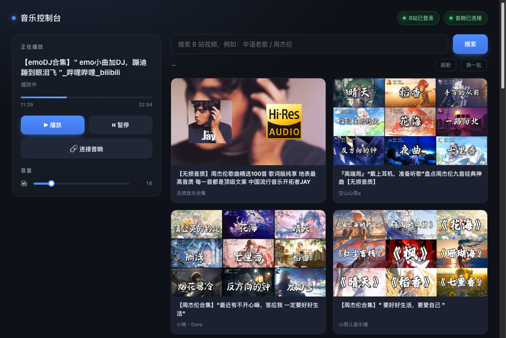

# 音乐控制台（Music Control Web · macOS 版）

躺在床上，用手机控制 Mac 上的浏览器放 B 站歌，声音从蓝牙音箱出来。



## 为什么写这个项目

这是 [media-control](https://github.com/standbyme626/media-control)（Windows 版）的 macOS 版本。

Windows 版解决的是「躺在被窝里控制台式机放歌」。后来主力听歌设备换成了 MacBook——它接着一个蓝牙音箱，人在沙发上刷手机，想切歌就得起来掀盖子、解锁、找到窗口。

远程桌面同样太重。真正需要的只有三件事：**现在放的是什么、暂停还是继续、下一首放什么**。

于是有了这个：Mac 上跑一个受控浏览器负责「放」，服务器上跑一个网页负责「控」，手机上打开网页点两下就行。

## 和 Windows 版的区别

| | Windows 版 | macOS 版（本仓库） |
|---|---|---|
| 播放控制 | WinRT SMTC + 媒体键回退 | CDP 直接操作页面里的 video 元素 |
| 音量 | pycaw 调系统主音量 | CDP 调播放器音量，系统音量在控制面外 |
| B 站搜索 | 抓搜索页 DOM | 直接调 B 站搜索接口（见下文） |
| 蓝牙 | 不涉及 | IOBluetooth 框架查状态 / 连接 |
| 受控浏览器 | Edge + 独立 profile | 同左，Chrome 也可以 |

Windows 那套依赖 WinRT 和 pycaw，macOS 上都没有，所以这版全部走 CDP——只要能通过浏览器放出来的声音，都能控。

## 功能

- **B 站搜索**：封面、标题、UP 主，调官方接口，不解析 DOM。
- **点卡片播放**：在受控浏览器里打开对应 BV 号并自动开始播放。
- **播放 / 暂停 / 音量**：CDP 操作页面元素，立即生效。
- **10 分钟自动刷新**（页面可见时才刷）+ 手动「刷新」+「换一批」翻页。
- 顶部显示上次刷新时间和倒计时；刷新失败保留旧列表，不白屏。
- **扫码登录**：网页里直接显示 B 站登录二维码，手机扫一下就登录，登录态存在专用 profile 里。
- 蓝牙音箱连接状态显示与一键重连。
- 手机 / 平板 / 电脑浏览器通用，桌面双栏、窄屏自动单列。

## 架构

```
手机 / 电脑浏览器
        │ HTTP（局域网，可选 Basic 认证）
        ▼
music-web（服务器，Python 标准库，:8098）
        │ SSH 固定命令（参数白名单，不经 shell）
        ▼
music-bridge（Mac，127.0.0.1:8765）
        ├─ CDP ws://127.0.0.1:9222（受控浏览器）
        └─ IOBluetooth（蓝牙音箱状态 / 连接）
        │
        ▼
受控浏览器播放 → macOS 音频输出 → 蓝牙音箱
```

- `server/app.py`：网页与 API，固定动作端点，参数只接受整数或 BV 号，转发 URL 用 `shlex.quote` 包裹。
- `server/page.html`：单文件页面，无构建、无第三方依赖。
- `bridge/bridge.py`：Mac 侧小 HTTP 服务，只绑 `127.0.0.1`，只接受固定动作。
- 受控浏览器用独立 profile 启动，开 `--remote-debugging-port=9222`，登录一次长期有效。

## 为什么搜索走接口而不是抓 DOM

第一版是抓搜索页的 `.bili-video-card`，实测在这台机器上不工作：搜索页骨架正常加载（导航栏、结果计数「99+」都在），但**结果列表区域始终空白**，DOM 里一个视频卡片都没有。

排查结果：UA 正常（不是 headless）、`navigator.webdriver === false`、网络请求没有任何 4xx/5xx、页面已登录（`DedeUserID` 存在），但结果就是渲染不出来。

而同一页面上下文里直接 fetch 官方搜索接口，返回 `{"code": 0, "n": 20}`，数据完全正常。

所以最终改成**在页面上下文里调接口**：同源、自动带 cookie、不依赖前端渲染，顺带把搜索耗时从约 20 秒降到约 2 秒。

## 快速开始

### 一、Mac 侧

1. 装一个 Chromium 系浏览器（Edge 或 Chrome，Safari 不支持 CDP）：

```bash
brew install --cask microsoft-edge   # 或 google-chrome
```

2. 装 Python 依赖（系统自带 python3 即可）：

```bash
python3 -m pip install --user websocket-client pyobjc-framework-IOBluetooth
```

3. 放桥的代码：

```bash
mkdir -p ~/music-bridge
cp bridge/bridge.py ~/music-bridge/
```

4. 启动受控浏览器（首次会打开 B 站，扫码登录一次）：

```bash
./scripts/start-browser.sh
```

5. 启动桥：

```bash
MB_BT_ADDR="AA-BB-CC-DD-EE-FF" ./scripts/start-bridge.sh
```

`MB_BT_ADDR` 是蓝牙音箱地址（`system_profiler SPBluetoothDataType` 里能看到），不填则跳过蓝牙相关接口。

### 二、服务器侧

1. 配 SSH 免密（服务器 → Mac）：

```bash
ssh-keygen -t ed25519
ssh-copy-id 你的用户名@Mac的IP
# ~/.ssh/config 里加：
# Host mac
#     HostName 192.168.1.20
#     User yourname
```

2. 部署网页：

```bash
mkdir -p /opt/music-web
cp server/app.py server/page.html /opt/music-web/
```

3. 跑起来：

```bash
MW_MAC=mac python3 /opt/music-web/app.py
```

或用 systemd，见 `deploy/music-web.service`。

4. 浏览器打开 `http://服务器IP:8098/`。

## 配置项

| 变量 | 默认 | 说明 |
|---|---|---|
| `MW_PORT` | 8098 | 网页端口 |
| `MW_MAC` | mac | SSH 到 Mac 的主机别名 |
| `MW_BRIDGE` | http://127.0.0.1:8765 | Mac 上桥的地址（经 SSH 访问） |
| `MW_AUTH` | 0 | 设 1 启用 Basic 认证 |
| `MW_USER` / `MW_PASSWORD` | media / 空 | 认证账号，密码为空时拒绝所有请求 |
| `MB_PORT` | 8765 | 桥端口（只绑 127.0.0.1） |
| `MB_CDP_PORT` | 9222 | 受控浏览器调试端口 |
| `MB_BT_ADDR` | 空 | 蓝牙音箱地址，留空则关闭蓝牙功能 |
| `MB_BT_NAME` | 空 | 音箱名称，不填会自动从 IOBluetooth 读 |

## 接口

| 方法 | 路径 | 说明 |
|---|---|---|
| GET | `/` | 控制页面 |
| GET | `/api/status` | 当前播放、音量、登录态、蓝牙状态 |
| GET | `/api/search?q=&page=` | B 站搜索 |
| POST | `/api/open?bv=` | 打开并播放指定视频 |
| POST | `/api/play` `/api/pause` | 播放 / 暂停 |
| POST | `/api/volume?level=` | 调播放器音量 |
| GET | `/api/qr` | 打开登录页并返回二维码截图 |
| POST | `/api/bt?action=connect` | 连接蓝牙音箱 |

## 安全说明

- 默认**不带认证**，面向家庭局域网。要暴露到公网请务必 `MW_AUTH=1` 并配反向代理 / HTTPS。
- 网页只能触发固定动作：BV 号经过 `^BV[0-9A-Za-z]{8,14}$` 白名单，音量只接受 0–100 整数。
- 服务器不执行传入的字符串；转发到桥的 URL 经 `shlex.quote` 包裹。
- 桥只监听 `127.0.0.1`，外部必须经 SSH 才能访问。
- 受控浏览器使用独立 profile，B 站登录态只存在那台 Mac 上。

## 已知限制

- 点歌到出声约 2–5 秒（导航 + 视频起播），不是秒响应。
- Mac 休眠 / 合盖会断，需要保持唤醒（`caffeinate`）。
- 音量控制的是播放器音量，不是系统音量；系统音量在 Mac 上单独调。
- 蓝牙音箱若声明不支持 AVRCP 绝对音量，软件调不了它的硬件音量。
- B 站二维码 180 秒过期，页面里可以点「刷新二维码」。

## 目录结构

```
server/app.py              网页与 API（Python 标准库）
server/page.html           单文件前端
bridge/bridge.py           Mac 侧 CDP 桥
scripts/start-browser.sh   启动受控浏览器
scripts/start-bridge.sh    启动 / 重启桥
config.example.env         配置示例
deploy/                    systemd 与 LaunchAgent 模板
```

## License

MIT
